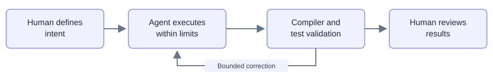

# HaMi AI Engineering Agent

**Human-led. AI-assisted. Engineering you can verify.**

What if AI agents could handle more of the software development process without constantly waiting for human intervention — while keeping engineers in control of architecture, quality, and critical decisions?

HaMi AI Engineering Agent explores exactly that: a .NET 11-based approach to autonomous software engineering with isolated execution, bounded retries, compiler and test validation, and traceable decisions.

**The goal isn't to replace software engineers. It's to eliminate unnecessary interruptions while preserving engineering discipline.**



This is our engineering vision. The current implementation is an incremental, deliberately bounded prototype.

## Current capabilities

- Historical issue replay without exposing the reference solution to the model during generation.
- Versioned task contracts, scoped changes and isolated Git worktrees.
- C# generation with compiler/test feedback and bounded correction.
- System.CommandLine and Akka.NET-based job orchestration for a restricted development workflow.
- Experimental Docker MicroVM execution, with a fresh guest per real coding attempt.
- Structured logs and JSON reports for traceable outcomes.

General autonomous issue-to-PR development remains a goal, not a completed capability. See [capabilities and limitations](docs/capabilities.md).

## See it in action

With Git and the .NET SDK specified in [global.json](global.json), clone the repository and run:

```sh
git clone https://github.com/Snahdul/HaMi-AI-Engineering-Agent.git
cd HaMi-AI-Engineering-Agent
dotnet run --project src/HaMi.Agentic.Cli -c Release -- development --repo . --agent-self-test
```

The offline self-test exercises a failed compilation scenario, successful correction, exhausted retry budget and timeout handling. No API key, Docker or paid model call is needed. It uses controlled test components.

For real compiler and deterministic test validation on a restricted C# task, see the [coding retry example](docs/examples/coding-retry.md).

## Getting started

Read the [developer quickstart](docs/getting-started.md) for prerequisites and CLI commands.

## Architecture and roadmap

Built with C#, .NET 11, vertical slices, System.CommandLine and Akka.NET. Model integration is deliberately separated from execution policy and validation.

- [Architecture overview](docs/architecture-overview.md)
- [Architecture guidelines](docs/architecture-guidelines.md)
- [CommandLine and Akka architecture decision](docs/decisions/0001-commandline-akka-isolated-coding.md)
- [Project board and roadmap](https://github.com/users/Snahdul/projects/2/views/1)

## Documentation

- [Development history and historical operating instructions](docs/development-history.md)
- [Logging](docs/logging.md)
- [Security policy](SECURITY.md)
- [HaMi AI Engineering methodology](https://github.com/Snahdul/HaMi-AI-Engineering)

The methodology and its implementation evolve together. Human review remains the boundary for consequential decisions, merges and deployments.
