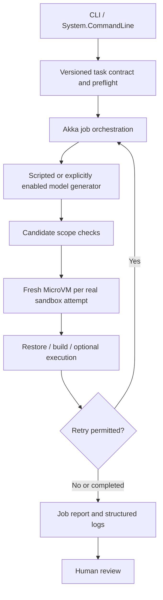

# Architecture overview

[Back to README](../README.md)

The current implementation is a .NET 11 CLI organized around vertical slices. System.CommandLine routes explicit commands. The development slice uses Akka.Hosting to orchestrate a bounded coding job.

This diagram describes the bounded development flow, not a general multi-agent platform. Offline tests substitute controlled components for real sandbox execution. The host enforces scope and retry limits; generated code is not trusted. See the [architecture decision](decisions/0001-commandline-akka-isolated-coding.md), [architecture guidelines](architecture-guidelines.md), [logging](logging.md) and [security policy](../SECURITY.md).
